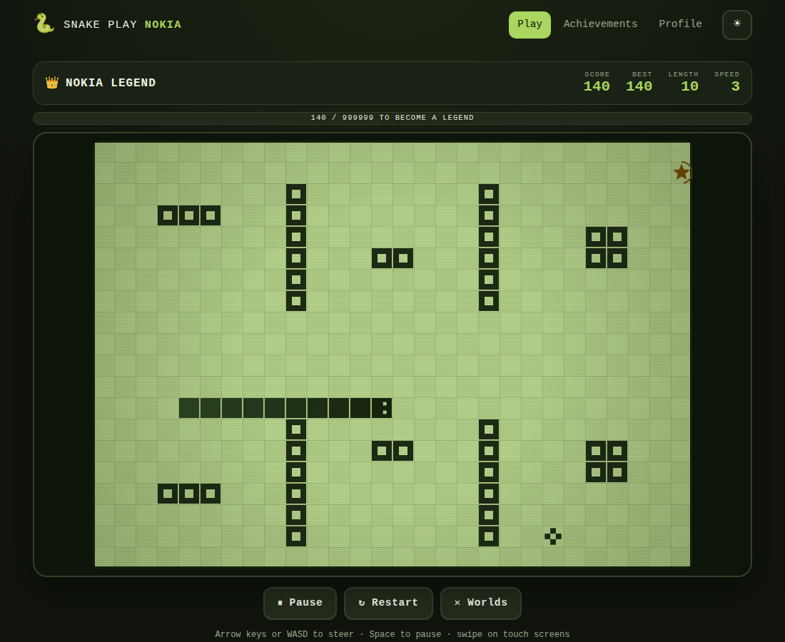
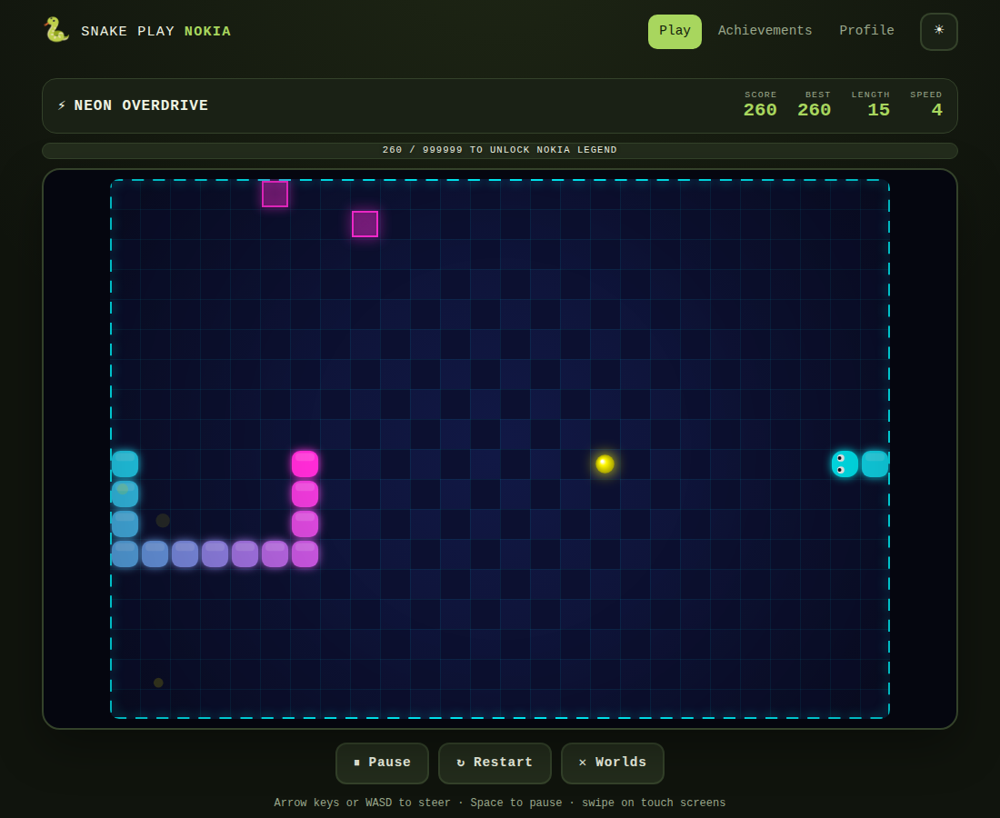

# 🐍 Snake Play Nokia

A Nokia-style Snake game with **five worlds**, bonus stars, achievements and a day/night theme.
Built with plain **HTML, CSS and JavaScript** — no frameworks, no build step, no dependencies.

> Open `index.html` in any modern browser (double-click works), or host the folder on GitHub Pages.

<p align="center">
  
  
</p>

## Features

- **5 worlds** that unlock one after another: *Nokia Origins* (classic LCD), *Pixel Rush* (colourful, wrap-around),
  *Snake Maze* (stone corridors), *Neon Overdrive* (glowing arena with growing barriers) and *Nokia Legend* (final LCD maze).
- Canvas graphics per world: LCD pixels with scanlines, gradients, glow, particles, screen shake, animated bonus stars.
- Speed increases as you eat; reach each world's goal score to unlock the next (or keep playing in endless mode).
- Profile, per-world high scores, lifetime stats and **13 achievements**.
- Day / night theme, optional sound (synthesised, no audio files), optional grid and vibration.
- Keyboard (arrows / WASD, Space = pause), **swipe** and on-screen **D-pad** on mobile.
- Saves progress in `localStorage`; installable and playable **offline** (PWA).

## Controls

| Action | Keyboard | Touch |
| --- | --- | --- |
| Steer | Arrow keys / WASD | Swipe on the board, or D-pad |
| Pause / resume | Space, P or Esc | Pause button |
| Confirm | Enter | Tap |

## Project structure

```
snake-play-nokia/
├── index.html            Page shell (home, game, achievements, settings screens)
├── css/
│   ├── base.css          Reset, design tokens, day/night themes, top bar
│   ├── ui.css            Buttons, cards, panels, achievements, toasts
│   └── game.css          HUD, board, overlays, countdown, D-pad
├── js/                   Loaded in this order (plain scripts, one global: `SP`)
│   ├── config.js         Constants + the five world definitions (data only)
│   ├── storage.js        Save data (never throws, falls back to memory)
│   ├── audio.js          Synthesised sound effects
│   ├── engine.js         Pure game logic — no DOM, fully unit-tested
│   ├── renderer.js       Canvas drawing for every world style
│   ├── input.js          Keyboard, swipe and D-pad
│   ├── achievements.js   Achievement rules
│   ├── ui.js             DOM views (safe: text is never inserted as HTML)
│   └── app.js            Controller: routing, game loop, HUD, progress
├── tests/                Node's built-in test runner
├── assets/icon.svg
├── manifest.webmanifest  PWA manifest
└── service-worker.js     Offline cache
```

### Design notes

- `engine.js` knows nothing about the browser. `app.js` calls `game.step()` on a fixed tick and reacts to the returned
  events (`eat`, `bonus`, `die`, `win`…) with sound, particles and saving. This keeps the rules testable.
- Adding a world = adding one object to `SP.WORLDS` in `config.js` (size, speed, palette, optional maze `layout`).
  The tests check that every world's free cells are reachable and that the start area is clear.

## Development

```bash
npm test          # runs the 30 unit tests (Node 18+, no installs needed)
```

To preview locally with a server (optional): `python3 -m http.server 8080` and open http://localhost:8080.
After changing any file, bump `CACHE` in `service-worker.js` so installed copies update.

## Deploy on GitHub Pages

Repository → **Settings → Pages → Deploy from a branch → `main` / root**. The game will be live at
`https://<your-username>.github.io/<repo-name>/`.

## License

MIT © 2026 Kiyan Rahmati
